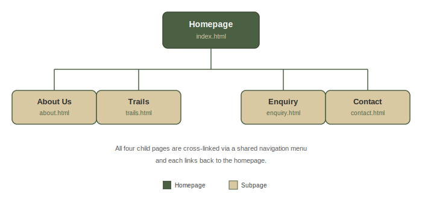
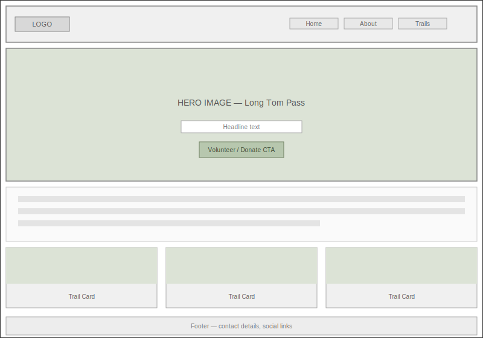
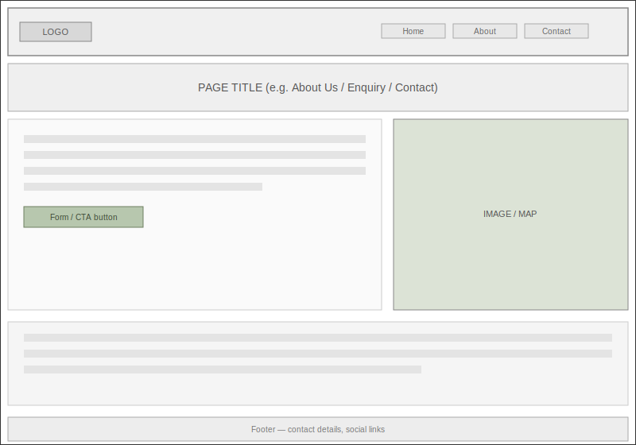
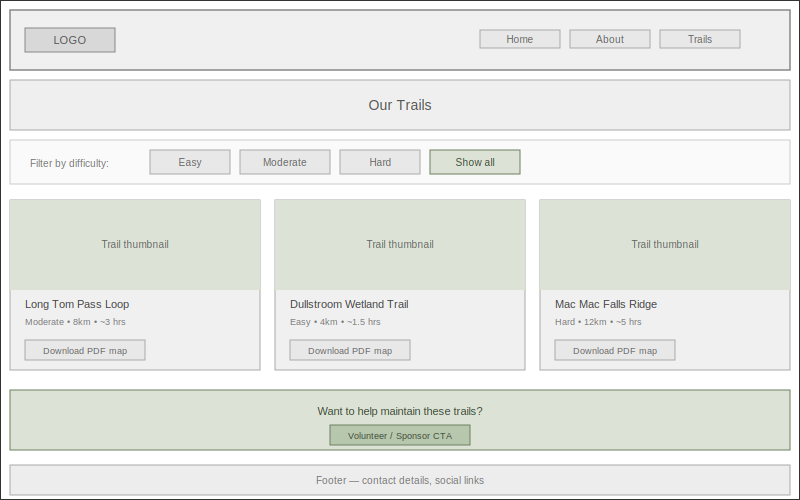
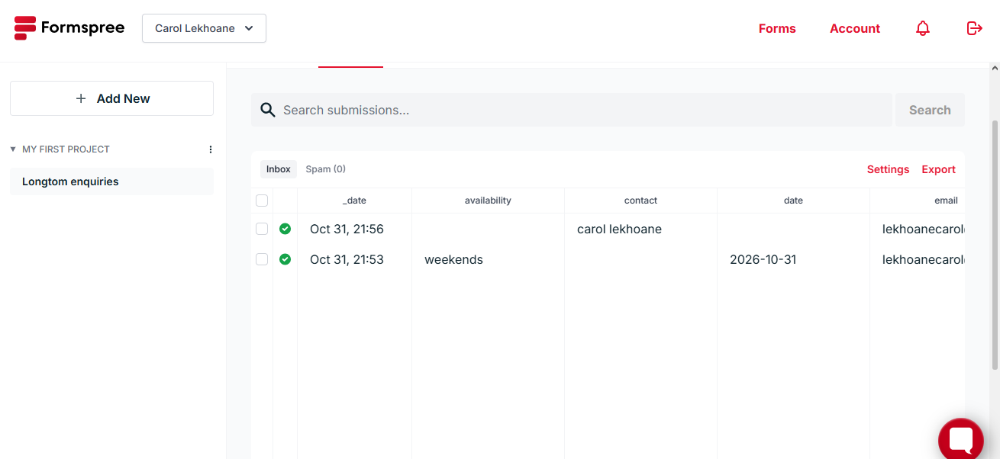
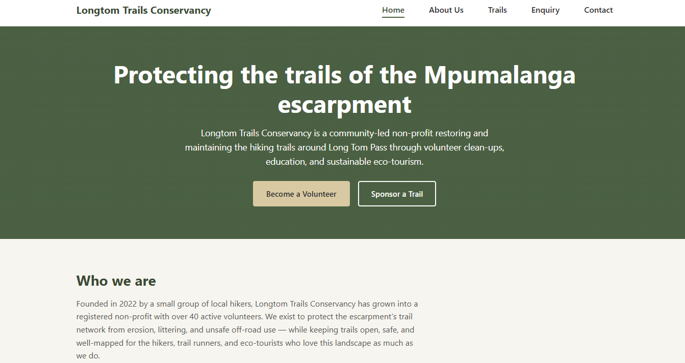
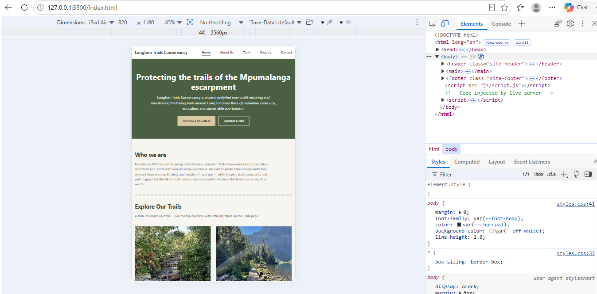
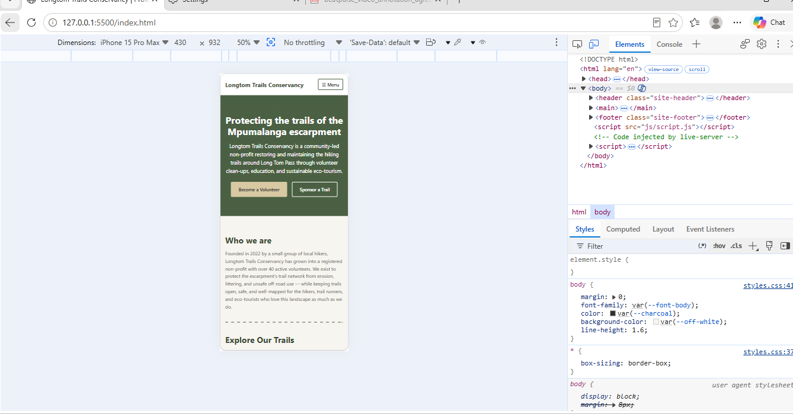

# Longtom Trails Conservancy: Website Project

## Student information
- **Full name:** Retshepile Carol Lekhoane
- **Student number:** ST10528017
- **Subject:** WEDE5020 Web Deveelopment
- **Organisation:** Longtom Trails Conservancy, a fictional non-profit in Lydenburg, Mpumalanga (Proposal 1, approved by the lecturer)

## Links
- **Live website:** https://longtomtrails.netlify.app
- **GitHub repository (private):** [PASTE YOUR REPOSITORY LINK]

## Contents
1. [Project overview](#1-project-overview)
2. [Goals, objectives and KPIs](#2-goals-objectives-and-kpis)
3. [Current situation analysis](#3-current-situation-analysis)
4. [Sitemap and wireframes](#4-sitemap-and-wireframes)
5. [Part 3 features and functionality](#5-part-3-features-and-functionality)
6. [Search engine optimisation (SEO)](#6-search-engine-optimisation-seo)
7. [Security](#7-security)
8. [Performance and Lighthouse results](#8-performance-and-lighthouse-results)
9. [Responsive design and testing](#9-responsive-design-and-testing)
10. [Deployment](#10-deployment)
11. [File and folder structure](#11-file-and-folder-structure)
12. [Known limitations and placeholders](#12-known-limitations-and-placeholders)
13. [Image credits](#13-image-credits)
14. [Changelog](#14-changelog)
15. [References](#15-references)

---

## 1. Project overview
Longtom Trails Conservancy is a community-led non-profit that protects and restores hiking trails on the Mpumalanga escarpment through volunteer clean-ups, education and sustainable eco-tourism. It was founded in 2022 by local hikers and has over 40 active volunteers. This five-page website lets visitors find trails, volunteer, sponsor a trail, and contact the conservancy.

| Page | File | Purpose | Main features |
|---|---|---|---|
| Home | `index.html` | Introduces the conservancy and its featured trails | Hero section, featured trail cards, calls to action |
| About Us | `about.html` | History, mission, team, photos and FAQ | Bio modal, photo gallery with lightbox, jQuery FAQ accordion |
| Trails | `trails.html` | Trail directory | Trails built by JavaScript, search, sort, difficulty filter |
| Enquiry | `enquiry.html` | Volunteer and sponsor enquiries | Two validated forms, AJAX submission, dynamic responses |
| Contact | `contact.html` | Where to find us and general messages | Leaflet map, nearest-location finder, email-compose form |

## 2. Goals, objectives and KPIs

| Goal | Measurable objective | How it is measured | Target | Feature that supports it |
|---|---|---|---|---|
| Recruit volunteers | Visitors register for the monthly clean-up hike online | Volunteer submissions received in Formspree | 10 registrations per month | Volunteer form with a response showing the next hike date and spots left |
| Raise sponsorship | Businesses can see package prices and enquire without phoning | Sponsor submissions received in Formspree | 2 enquiries per quarter | Sponsor form that shows cost, instalments and availability |
| Provide trail information | Hikers can find a trail that suits their fitness level | Trail search, sort and filter in use | Every trail reachable in 2 clicks or fewer | Trails page search, sort and difficulty filter |
| Make us easy to find | Visitors can locate and travel to the nearest meeting point | Map and directions links on the Contact page | Both locations visible on one map | Leaflet map, nearest-location finder, Get directions links |
| Be found on search engines | Pages rank for local hiking and volunteering searches | Lighthouse SEO score and valid structured data | SEO score 95 or above on every page | SEO work in section 6 |
| Work for every visitor | Site is usable on phones, tablets and desktops, and by keyboard and screen reader | Lighthouse accessibility score and responsive tests | Accessibility 95 or above | Responsive CSS, labelled forms, ARIA attributes |

## 3. Current situation analysis
The conservancy has no website. Its online presence is a Facebook group and a WhatsApp community, so the analysis compares those channels with what the website adds.

| Existing channel | Strengths | Weaknesses | How the website improves it |
|---|---|---|---|
| Facebook group | Existing members, easy to post updates | Not found by people searching for hiking, posts are hard to find later, requires an account | Pages that search engines can index, with permanent trail information |
| WhatsApp community | Fast and personal for volunteers | Closed group, so newcomers cannot find it, no record of trail details | Public volunteer form with an instant response |
| Word of mouth | Trusted by the local community | Reaches only people who already know the group | Local SEO, structured data and a map for people who do not |

**Areas for improvement identified:** no way for sponsors to see what they would be paying for, no single place for trail difficulty and distance, no map of the meeting points, and no search presence. Sections 5 and 6 describe how each was addressed.

## 4. Sitemap and wireframes







## 5. Part 3 features and functionality

### 5.1 Forms, validation and AJAX
All three forms share one validation system in `js/script.js`. The HTML5 attributes (`required`, `pattern`, `minlength`, `maxlength`) hold the rules, and JavaScript reads them, so each rule is written in one place (MDN Web Docs, n.d.a). The forms use `novalidate` so the browser's own pop-ups are replaced by consistent messages written under each field. The first invalid field is focused, and fields re-check as the user types once an error is showing.

| Form | Field | Rule |
|---|---|---|
| Volunteer (`enquiry.html`) | Full name | Required, 2 to 60 characters |
| | Email | Required, valid email format |
| | Cell number | Required, South African format (`0821234567` or `+27821234567`) |
| | Preferred date | Required, from today up to 180 days ahead |
| | Availability | Required choice |
| | What would you like to help with? | Required, 10 to 300 characters, live character counter |
| Sponsor (`enquiry.html`) | Organisation, contact person | Required, 2 to 80 and 2 to 60 characters |
| | Email, phone | Required, same formats as above |
| | Package, payment option | Required choices |
| | Message | Optional, up to 300 characters |
| Contact (`contact.html`) | Name, email | Required |
| | Phone | Optional, South African format if filled in |
| | Type of message | Required choice |
| | Message | Required, 20 to 500 characters |

**Enquiry responses.** After validation, the form data is sent in the background with `fetch` (AJAX) to Formspree, so the page does not reload (MDN Web Docs, n.d.d; Formspree, n.d.). The button is disabled while sending, and a red message appears if sending fails.
- **Volunteers** are told the date of the next clean-up hike on or after their chosen date (the first Saturday of each month, 07:30) and how many spots are left.
- **Sponsors** are told the cost of the package they chose, the monthly instalment if they pick 12 payments (cost divided by 12, rounded up), what the package covers, and how many places are left this year.

**Contact form.** After validation the details are compiled into an email addressed to `info@longtomtrails.org.za`, shown as a preview, and opened in the visitor's email app with a `mailto:` link. A Copy button is also provided.


Test submissions are visible in the Formspree dashboard: 

### 5.2 Dynamic content, search and sort
`js/trails.js` stores the trails as a list of data and builds each trail card with DOM methods (`createElement`, `replaceChildren`), instead of the cards being written by hand in the HTML. The visitor can:
- **Search** by typing. Every word typed must appear somewhere in the trail's name, description, difficulty, location or tags, so "easy wetland" finds the Dullstroom trail and "easy ridge" finds nothing.
- **Filter** by Easy, Moderate or Hard.
- **Sort** by difficulty, name, distance (shortest or longest) or time.

A results count ("Showing 1 of 3 trails") is announced to screen readers, and a "no trails match" message with a reset button appears when nothing matches. To add a trail, add one entry to the list.

### 5.3 Interactive elements and animation
| Element | Page | How it works |
|---|---|---|
| Bio modal | About | The "Read bio" button opens a native HTML `<dialog>`, filled from the team card (MDN Web Docs, n.d.c). Esc, the close button and a click outside all close it |
| Photo gallery with lightbox | About | Thumbnails are normal links, so they still work without JavaScript. With JavaScript they open a lightbox with previous and next buttons and arrow-key support |
| FAQ accordion | About | Built with jQuery 3.7.1 (jQuery, n.d.). Opening one answer closes the others, using `aria-expanded` for screen readers |
| Scroll animation | All pages | Sections fade in as they enter the screen, using an `IntersectionObserver` and CSS transitions (MDN Web Docs, n.d.f) |
| Card and button transitions | All pages | CSS transitions for hover lift and pressed states |
| Card fade-in | Trails | CSS keyframe animation with a delay between cards |

Animations are switched off for visitors who set "reduce motion" on their device (MDN Web Docs, n.d.g).

### 5.4 Interactive map
The Contact page uses Leaflet with OpenStreetMap tiles (Leaflet, n.d.a; OpenStreetMap, n.d.). The location details are stored once, in the location cards in the HTML, and the script reads them to create the markers.
- Numbered markers with popups, and **Show on map** buttons that fly to a location.
- **Find my nearest meeting point** asks the browser for the visitor's location (MDN Web Docs, n.d.e), works out the straight-line distance to each location with Leaflet, and shows the nearest one with a distance. The location is used only in the visitor's browser and is never sent anywhere.
- Get directions links open the route in Google Maps (Google Maps Platform, n.d.).
- Wheel zoom is off until the map is clicked, and one-finger dragging is off on phones, so the map never traps scrolling.
- If the map fails to load, a message is shown and the list of locations stays visible.

## 6. Search engine optimisation (SEO)

### 6.1 Keyword plan
| Page | Primary keyword | Secondary keywords | Where used |
|---|---|---|---|
| Home | hiking trails Mpumalanga | trail conservation, Lydenburg, volunteer clean-up | Title, meta description, H1, structured data |
| About | trail conservation Lydenburg | Mpumalanga escarpment, conservancy volunteers | Title, meta description, headings, FAQ |
| Trails | hiking trails near Lydenburg | Dullstroom hiking trails, Long Tom Pass, easy hiking trails | Title, H1, trail descriptions, image alt text, ItemList data |
| Enquiry | volunteer trail clean-up | sponsor hiking trails | Title, meta description, H1 |
| Contact | Longtom Trails Conservancy contact | Lydenburg, Dullstroom | Title, meta description, opening hours, ContactPage data |


### 6.2 On-page SEO
| Item | What was done |
|---|---|
| Title tags | A unique title on every page, all under 60 characters (48 to 57), with the main keyword near the start |
| Meta descriptions | A unique description on every page, 133 to 153 characters |
| Header tags | One `<h1>` per page, then `<h2>` and `<h3>` in order. The Trails and Enquiry headings now contain their keywords |
| Image optimisation | Descriptive file names (for example `mac-mac-falls-ridge.jpg`, renamed from a misspelled name), descriptive alt text on every photo, width and height set, lazy loading below the top of the page |
| URL structure | Short lowercase names: `/about`, `/trails`, `/enquiry`, `/contact` (Netlify serves them without `.html`), and the canonical links use the same form |
| Internal linking | Every page is linked from the menu and footer. The FAQ answers and call-to-action banners link to the Enquiry, Trails and Contact pages |
| Mobile-friendliness | Responsive layout with a viewport tag, tested at desktop, tablet and phone sizes (section 9) |
| Language and region | `lang="en-ZA"` and `og:locale` `en_ZA` for South African search |
| Canonical and social tags | A canonical link, Open Graph and Twitter Card tags with a 1200 by 630 sharing image (Open Graph protocol, n.d.) |
| Structured data (JSON-LD) | `NGO` with both locations and opening hours on the Home page (Schema.org, n.d.), `FAQPage` on About, `ItemList` on Trails, `ContactPage` on Contact |

The FAQ markup matches the visible questions and answers (Google Search Central, n.d.a). Google now shows FAQ rich results only for a limited set of sites, so the markup helps search engines understand the page, but a rich result is not guaranteed.

### 6.3 Technical SEO files
- **`robots.txt`** allows all crawlers, blocks the `/docs/` folder (wireframes and test screenshots) and points to the sitemap (Google Search Central, n.d.b).
- **`sitemap.xml`** lists all five pages using the same addresses as the canonical links (Sitemaps.org, n.d.).
- **`favicon.svg` and `favicon-192.png`** give the site a browser-tab icon.

### 6.4 Off-page SEO plan
Off-page SEO is work done outside the website. For a fictional organisation these are planned actions and are not carried out.
- **Backlinks:** ask the Thaba Chweu local tourism office, Mpumalanga hiking clubs, guesthouses in Lydenburg and Dullstroom, and sponsors to link to the site, giving each sponsor a "Thank you" listing that links to their own site.
- **Social media:** the footer links to the Facebook and Instagram profiles, and each platform would link back to the site. Clean-up hike photos would be posted with links to the Enquiry page, and the sharing image makes shared links look branded.
- **Local SEO:** the same name, address and opening hours appear on the Contact page, in the structured data and in the footer. The plan is to claim a Google Business Profile for each of the two locations and to list the conservancy on local directories.

## 7. Security
| Measure | Detail |
|---|---|
| HTTPS | Netlify serves the site over HTTPS, which the location feature also needs |
| Content Security Policy | `_headers` lets scripts and styles load only from the site itself, unpkg.com (Leaflet) and code.jquery.com (jQuery). Maps come only from OpenStreetMap and form data goes only to Formspree (MDN Web Docs, n.d.b; Netlify, n.d.b) |
| Subresource Integrity | The jQuery script and the Leaflet script and stylesheet carry an `integrity` hash, so the browser refuses a changed file (MDN Web Docs, n.d.h) |
| Other headers | `X-Content-Type-Options: nosniff`, `X-Frame-Options: DENY` (blocks clickjacking), `Referrer-Policy`, and `Permissions-Policy` (camera and microphone off, location only for the site itself) |
| Safe output | Anything a visitor types is shown with `textContent`, never `innerHTML`, so it cannot run as code |
| Safe links | External links use `rel="noopener noreferrer"` |
| Input checking | Every field is validated before sending. This is client-side only (see section 12) |

## 8. Performance and Lighthouse results
Lighthouse was run on the live site with the mobile setting.

| Page | Performance | Accessibility | Best Practices | SEO |
|---|---|---|---|---|
| Home | 25 | 98 | 92 | 100 |
| About | 29 | 98 | 92 | 92 |
| Trails | 63 | 98 | 92 | 100 |
| Enquiry | 59 | 98 | 92 | 100 |
| Contact | 26 | 99 | 88 | 100 |

**Notes**
- Lighthouse reported that browser extensions affected these runs. Console errors such as "Could not establish connection. Receiving end does not exist" and `content.js` come from extensions, not from the site, and lower the Best Practices score.
- The Contact page logged one genuine error: a request for `leaflet.js.map` was blocked by the Content Security Policy. It was fixed by adding `unpkg.com` to `connect-src`.
- Mobile Performance is the weakest score. Lighthouse's mobile test slows the connection on purpose, so large photos hurt most. Photos were resized (1600px wide for trails, 900px for team photos) and compressed with Squoosh (GoogleChromeLabs, n.d.), and images below the first screen load lazily (web.dev, n.d.).

Screenshots of each run are in `docs/` (for example `docs/lighthouse-home.png`). Scores come from Lighthouse (Chrome for Developers, n.d.).

## 9. Responsive design and testing
Media queries change the layout at three sizes: tablet (up to 1024px), the map layout (up to 860px) and phone (up to 720px), where the navigation collapses into a menu button. Spacing and type use relative units.

**Desktop**


**Tablet (iPad Air, 820px)**


**Mobile (iPhone SE)**


**Functional tests**
| Test | Expected result | Result |
|---|---|---|
| Submit the volunteer form empty | A red message under every required field | Pass |
| Submit the volunteer form correctly | Green response with the next hike date and spots left | Pass |
| Submit the sponsor form with monthly payment | Response shows the cost, monthly amount and places left | Pass |
| Create an email on the Contact page | Email preview with To, Subject and body, and an Open in email app button | Pass |
| Search "wetland" on Trails | Only the Dullstroom trail remains, count updates | Pass |
| Search "easy ridge" | "No trails match" message with a reset button | Pass |
| Sort by distance | Cards reorder | Pass |
| Click Read bio | Modal opens with photo, role and bio | Pass |
| Open a gallery photo, then press the right arrow key | Lightbox shows the next photo | Pass |
| Click an FAQ question | Answer slides open and others close | Pass |
| Find my nearest meeting point | Browser asks permission, then the nearest location and distance appear | Pass |
| Resize the browser to phone width | Menu button appears, layout is one column | Pass |

## 10. Deployment
The site is hosted on Netlify's free plan (Netlify, n.d.a). The lecturer's repository is private, and GitHub Pages needs a public repository on a free account, so Netlify was used instead.
1. The project folder is dragged onto the site's **Deploys** tab in Netlify.
2. Netlify publishes it over HTTPS at https://longtomtrails.netlify.app and applies the `_headers` file.
3. The `/robots.txt` and `/sitemap.xml` addresses were checked in the browser after each deploy.

Each deploy replaces the live site. The code and the live site are kept the same by uploading the same files to GitHub.

## 11. File and folder structure
```
longtom-trails/
├── index.html
├── about.html
├── trails.html
├── enquiry.html
├── contact.html
├── styles.css
├── favicon.svg
├── favicon-192.png
├── robots.txt
├── sitemap.xml
├── _headers
├── README.md
├── js/
│   ├── script.js        navigation, forms, animation, modal, lightbox, accordion, map
│   └── trails.js        trail data, search, sort and filter
├── images/
│   ├── logo.png
│   ├── og-image.png
│   ├── trail-thumbnails/
│   └── team-photos/
└── docs/                sitemap, wireframes and test screenshots
```

## 12. Known limitations and placeholders
- The organisation, team, bios, opening hours and addresses are fictional. Map coordinates are the centre of each town, not an exact street position.
- Hike spot numbers and sponsor package places are demo data stored in `script.js`. A real site would read them from a database.
- The "Download PDF map" buttons are placeholders (`href="#"`), because no trail maps exist for the fictional trails.
- The Facebook and Instagram links are placeholder addresses.
- Validation runs in the browser and a determined user could bypass it. A live site would also validate on the server.
- `style-src` allows `'unsafe-inline'` because the pages use some inline `style` attributes.
- The "nearest meeting point" feature needs the visitor's permission and a secure (HTTPS) page, and it measures straight-line distance, not driving distance.
- The Contact form depends on the visitor having an email app set up.
- Off-page SEO (section 6.4) is a plan only.
- The proposal's production hosting plan (a South African host) is unchanged. Netlify is used for this assessment.

## 13. Image credits
<!-- TODO: Fill in the source and licence for every photo. Delete any row you do not use. -->
| Image | Used on | Source | Licence |
|---|---|---|---|
| dullstroom-wetland.jpg | Home, Trails, About | [website or "my own photo"] | [for example Unsplash licence] |
| long-tom-pass-loop.jpg | Home, Trails, About | [source] | [licence] |
| mac-mac-falls-ridge.jpg | Home, Trails, About | [source] | [licence] |
| Team photos | About | [source] | [licence or "permission given"] |
| Map tiles | Contact | OpenStreetMap contributors | Open Database Licence |
| Logo, favicon, sharing image | All pages | Designed for this project | Own work |

## 14. Changelog
Each entry says what changed, why, and which files were involved.

### Part 3: corrections from Part 2 feedback (91/100)
| Criterion (mark) | Feedback | What changed | Files |
|---|---|---|---|
| Feedback for Part 1 (7/10) | Good progress, minor improvements in consistency, detail or implementation | Finished the Part 1 items still open: wrote detailed goals with measurable targets (section 2) and a current-situation analysis (section 3), and corrected earlier changelog entries that described work that had not been done | `README.md` |
| GitHub commits (2/5) | Few commits, lacking descriptions | Part 3 was committed in separate steps, each with a summary line and a description of what changed and why. The commit list is on GitHub | GitHub history |
| README (4/5) | Present but could be improved | Rebuilt with live links, a contents list, goals, analysis, feature documentation, SEO, security, performance, testing, limitations and image credits | `README.md` |
| Changelog (4/5) | Present but could be improved | Every entry now follows the same pattern of what, why and which files, and feedback corrections have their own table | `README.md` |
| References (4/5) | Present but could be improved | Rebuilt around the sources actually used, in one Harvard format with in-text citations and access dates. References that could not be verified were removed | `README.md` |

### Part 3: new features and changes
**Forms**
- Added a shared validation system (required, email, South African phone, date range, length limits, character counters) with an error message under each field. *Why: the brief asks for JavaScript validation and error handling.* Files: `js/script.js`, `enquiry.html`, `contact.html`, `styles.css`.
- Added AJAX submission through Formspree and dynamic responses (next hike date and spots for volunteers, price and availability for sponsors). *Why: the brief wants a response related to cost or availability after validation.* Files: `js/script.js`, `enquiry.html`.
- Rebuilt the Contact form to compile an email and open it in the visitor's email app. *Why: the brief asks for the details to be compiled into an email sent to a recipient stated in the code.* Files: `js/script.js`, `contact.html`.

**Dynamic content and interaction**
- Trail cards are now built from data by JavaScript, with search, sort and difficulty filter. *Why: dynamic content and search are required, and one list is easier to maintain.* Files: `js/trails.js`, `trails.html`.
- Added a bio modal, photo gallery with lightbox and jQuery FAQ accordion. *Why: the brief asks for interactive elements.* The code was moved into `script.js` to avoid a separate file failing to load during development. Files: `about.html`, `js/script.js`, `styles.css`.
- Added scroll-reveal animation and button transitions. Files: `js/script.js`, `styles.css`.
- Replaced the two Google Maps embeds with a Leaflet map, a nearest-location finder and Show on map buttons. *Why: an interactive map library with no API key was required.* Files: `contact.html`, `js/script.js`, `styles.css`.

**SEO, security and performance**
- Rewrote every title and description, added canonical links, Open Graph tags, structured data, `lang="en-ZA"`, a favicon and a sharing image. Files: all five pages, `favicon.svg`, `favicon-192.png`, `images/og-image.png`.
- Added `robots.txt` and `sitemap.xml`. Changed canonical and sitemap addresses to the clean form Netlify serves (`/about`). Files: `robots.txt`, `sitemap.xml`, all pages.
- Made the Trails and Enquiry headings keyword-rich, and renamed `mac-false-ridge.jpg` to `mac-mac-falls-ridge.jpg`. *Why: descriptive names and headings help search engines.*
- Added a Content Security Policy and other security headers, plus integrity hashes on the jQuery and Leaflet files. File: `_headers`.
- Fixed a blocked `leaflet.js.map` request by allowing `unpkg.com` in `connect-src`. File: `_headers`.
- Resized and compressed photos, added width and height and lazy loading, and added `preconnect` hints for the jQuery and Leaflet servers.

**Fixes and clean-up**
- Taller photo boxes and set photo positions so faces are no longer cropped. Files: `about.html`, `styles.css`.
- Removed the placeholder team member, so the team now has six people. File: `about.html`.
- Enquiry and Contact pages now share the same header and styling as the other pages.

**Deployment**
- Deployed to Netlify at https://longtomtrails.netlify.app and tested every page, the map and the forms on the live site.

### Part 2: CSS styling and responsive design
- Created `styles.css`, linked to all five pages, with a colour palette, typography, a CSS reset and a consistent layout using Flexbox and CSS Grid. *Why: Part 2 required one stylesheet and a consistent look.*
- Added hover, focus and active states, card shadows and a "pressed" button effect.
- Added a tablet breakpoint (1024px) next to the phone breakpoint (720px), a JavaScript menu button for phones, and relative units.
- Designed a logo and added it to every page.
- Rewrote code comments so they explain what each block does and why.
- Added desktop, tablet and phone screenshots (section 9).

### Part 1 corrections (carried forward)
- Rewrote the features and functionality section of the proposal with detail on how each page works, and added three wireframes.
- Added justification for each technical choice in the proposal.
- Rebuilt the proposal budget with itemised costs.
<!-- TODO: Check the hosting and domain prices in your proposal against xneelo.co.za before you rely on the sentence saying they were checked. -->
- Added a visual sitemap (section 4).

## 15. References
MDN Web Docs (n.d.a) *Client-side form validation*. Available at: https://developer.mozilla.org/en-US/docs/Learn/Forms/Form_validation (Accessed: [14 September 2026])
MDN Web Docs (n.d.b) *Content Security Policy (CSP)*. Available at: https://developer.mozilla.org/en-US/docs/Web/HTTP/CSP(Accessed: [14 September 2026])

MDN Web Docs (n.d.c) *`<dialog>`: The Dialog element*. Available at: https://developer.mozilla.org/en-US/docs/Web/HTML/Element/dialog (Accessed: [14 September 2026])

MDN Web Docs (n.d.d) *Fetch API*. Available at: https://developer.mozilla.org/en-US/docs/Web/API/Fetch_API(Accessed: [14 September 2026])
MDN Web Docs (n.d.e) *Geolocation API*. Available at: https://developer.mozilla.org/en-US/docs/Web/API/Geolocation_API (Accessed: [16 September 2026])

MDN Web Docs (n.d.f) *Intersection Observer API*. Available at: https://developer.mozilla.org/en-US/docs/Web/API/Intersection_Observer_API (Accessed: [21 September 2026])
MDN Web Docs (n.d.g) *prefers-reduced-motion*. Available at: https://developer.mozilla.org/en-US/docs/Web/CSS/@media/prefers-reduced-motion (Accessed: [21 September 2026])

MDN Web Docs (n.d.h) *Subresource Integrity*. Available at: https://developer.mozilla.org/en-US/docs/Web/Security/Subresource_Integrity (Accessed: [21 September 2026])

Chrome for Developers (n.d.) *Lighthouse overview*. Available at: https://developer.chrome.com/docs/lighthouse/overview (Accessed: [21 October 2026])

Formspree (n.d.) *Formspree help*. Available at: https://help.formspree.io/ .(Accessed: [21 October 2026])


Google Maps Platform (n.d.) *Maps URLs*. Available at: https://developers.google.com/maps/documentation/urls/get-started (Accessed: [21 October 2026])

Google Search Central (n.d.a) *FAQ (FAQPage) structured data*. Available at: https://developers.google.com/search/docs/appearance/structured-data/faqpage (Accessed: [23 October 2026])


Google Search Central (n.d.b) *Introduction to robots.txt*. Available at: https://developers.google.com/search/docs/crawling-indexing/robots/intro ).
 (Accessed: [23 October 2026])
 
Google Search Central (n.d.c) *SEO starter guide*. Available at: https://developers.google.com/search/docs/fundamentals/seo-starter-guide  (Accessed: [23 October 2026])

GoogleChromeLabs (n.d.) *Squoosh*. Available at: https://squoosh.app/ ( (Accessed: [30 October 2026])

jQuery (n.d.) *.slideToggle()*. Available at: https://api.jquery.com/slidetoggle/  (Accessed: [26 October 2026])

Leaflet (n.d.a) *Leaflet API reference*. Available at: https://leafletjs.com/reference.html  (Accessed: [28 October 2026])

Leaflet (n.d.b) *Leaflet quick start guide*. Available at: https://leafletjs.com/examples/quick-start/ (Accessed: [29 October 2026])

Netlify (n.d.a) *Create deploys*. Available at: https://docs.netlify.com/site-deploys/create-deploys/ (Accessed: [28 October 2026])

Netlify (n.d.b) *Custom headers*. Available at: https://docs.netlify.com/routing/headers/(Accessed: [31 October 2026]
Open Graph protocol (n.d.) *The Open Graph protocol*. Available at: https://ogp.me/ (Accessed: [31 October 2026]

OpenStreetMap (n.d.) *Copyright and license*. Available at: https://www.openstreetmap.org/copyright(Accessed: [27 October 2026]
OpenStreetMap Foundation (n.d.) *Tile usage policy*. Available at: https://operations.osmfoundation.org/policies/tiles/  (Accessed: [31 October 2026]
Schema.org (n.d.) *NGO*. Available at: https://schema.org/NGO (Accessed: [31 October 2026]

Sitemaps.org (n.d.) *Sitemaps XML format*. Available at: https://www.sitemaps.org/protocol.html (Accessed: [02 November 2026]

W3C (2018) *Web Content Accessibility Guidelines (WCAG) 2.1*. Available at: https://www.w3.org/TR/WCAG21/  (Accessed: [01 November 2026]

web.dev (n.d.) *Browser-level image lazy-loading for the web*. Available at: https://web.dev/articles/browser-level-image-lazy-loading (Accessed: [01 November 2026]
